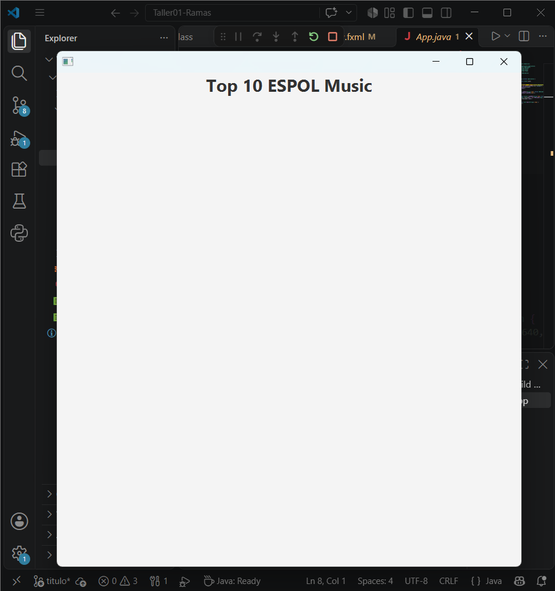
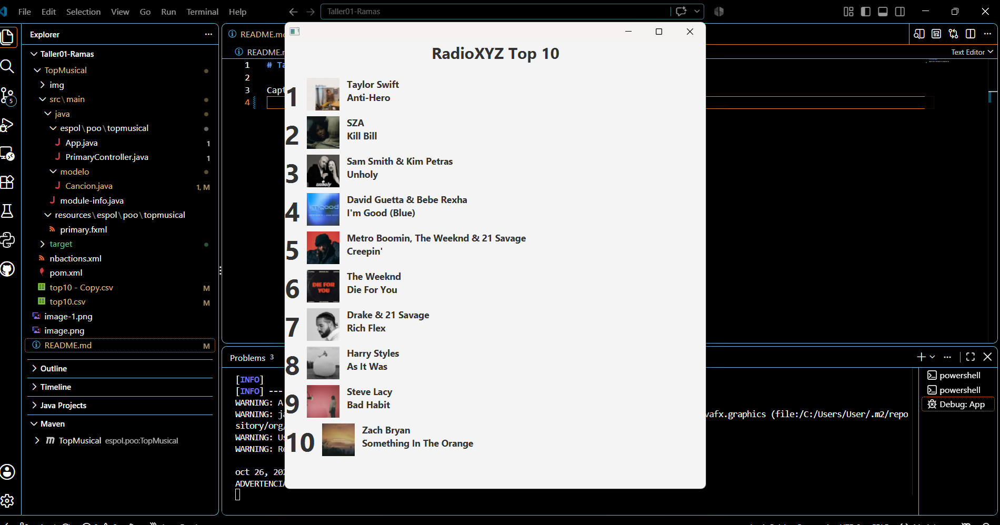

# Taller01-Ramas

## Integrante 1 - Rama titulo

Se modificó el archivo `primary.fxml` cambiando el encabezado principal por "Top 10 ESPOL Music".

### Evidencia del resultado

## Integrante 2 - Rama orden

Se modificó el método initialize() de PrimaryController.java,
agregando Collections.reverse(listaCanciones) para mostrar
las canciones desde la posición 10 hasta la posición 1.

Se ejecutó la aplicación y se verificó que el ranking
aparece correctamente en orden descendente.

### Evidencia del resultado

## Integrante 3 - Rama artista

Se modificó el orden en que el nombre del artista y la canción estaban en el constructor.

### Evidencia del resultado

